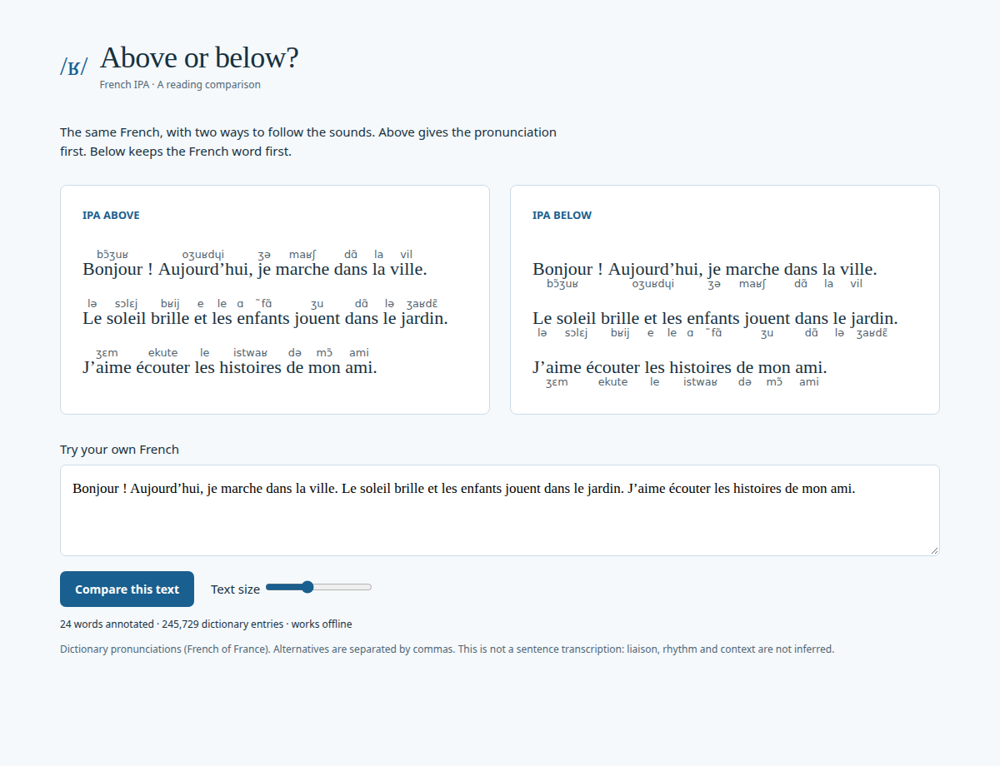

# French IPA

A Chrome extension that places IPA **above or below French words**, with a live comparison page. Pronunciations come from a bundled dictionary; page text never leaves the browser.



## Install

1. Download `french-ipa-0.1.0.zip` from [Releases](../../releases/latest) and extract it.
2. Open `chrome://extensions`, enable **Developer mode**, and choose **Load unpacked**.
3. Select the extracted folder containing `manifest.json`.
4. Open a French web page, click **French IPA** in the extensions menu, and choose **Show IPA on this page**.
5. Switch between **Above** and **Below**, or open **Compare both layouts** to try your own text.

For a source checkout, load the `extension/` directory instead. No build step is required. This is an unpacked extension, not a Chrome Web Store listing.

## Behavior

- Manual activation on the current tab; refresh resets activation. The preferred IPA position is saved.
- French of France dictionary, including inflected forms. Unknown words remain unchanged.
- Curly apostrophes, Unicode accents and common elisions such as `l’ami` are supported.
- Multiple dictionary pronunciations are shown together. The extension does not choose a meaning or infer liaison, enchaînement or sentence rhythm.
- Dynamically added text is annotated while enabled. Hiding IPA restores the text and keeps existing links and elements.
- Forms, editable regions, code, existing ruby, and explicitly tagged non-French sections are skipped.
- Activation treats the main page as French, even if its root language tag is missing or incorrect. It is not automatic language detection, so use it on French pages.
- Scanned text is in the main document, not iframes, shadow DOM, images or PDFs. Chrome settings and the Chrome Web Store cannot be annotated.
- Complex sites that continuously rebuild their own text may conflict with annotation. Turn IPA off if a page behaves unexpectedly.

## Privacy and permissions

Only `activeTab`, `scripting`, and `storage` are requested. There are no broad host permissions, accounts, analytics, remote scripts or runtime network services. The dictionary is bundled. `activeTab` gives temporary access when the extension is invoked; `storage` saves the layout preference locally.

## Develop and test

```sh
npm ci
npm test
npm run package
```

For the comparison page:

```sh
python3 -m http.server 8768 --bind 127.0.0.1 --directory extension
# Visit http://127.0.0.1:8768/preview.html
```

Optional isolated Chromium checks (with the server running):

```sh
npx playwright install chromium
node scripts/browser-check.cjs
```

The browser check covers rendering, mobile fit, editable preview text, extension loading and restricted-page feedback. DOM tests cover dictionary lookup, elisions, exclusion rules, restoration, duplicate prevention and live updates. Toolbar-click activation still needs a manual smoke test in a normal Chrome profile.

## Dictionary and license

French data: [open-dict-data/ipa-dict](https://github.com/open-dict-data/ipa-dict), `data/fr_FR.txt`. Its MIT notice is included in `extension/data/LICENSE`; source provenance is recorded in `extension/data/SOURCE.md`. The dictionary is a reading aid and may contain omissions or errors.

Extension code is MIT licensed. See [LICENSE](LICENSE).
